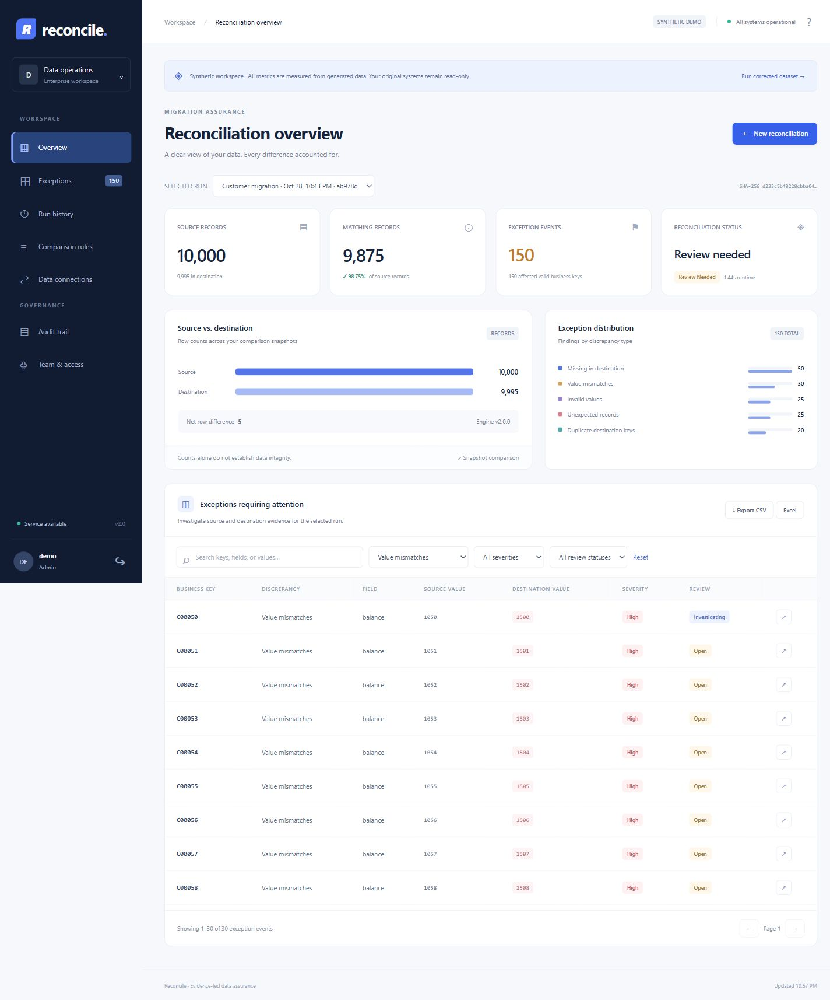

# Data Reconciliation Tool

Reconcile checks whether records arrived correctly after a migration or ETL job. It compares CSV files or PostgreSQL table pairs and shows missing records, duplicate keys, changed values, and schema differences. Matching row counts alone can hide these problems.

Choose a unique identifier or composite key, set the comparison rules, and run a check. The dashboard shows source and destination values beside each finding. Analysts can investigate a difference, record a decision, export the exceptions, and run another comparison after a correction.

Source and destination inputs stay read-only. Each run retains its snapshots, rules, and fingerprints so the result can be checked later.



The screenshot uses generated customer data. The local demo creates its own comparison, so the figures come from that run.

## Open the application

Requires Python 3.12 or later. The CSV engine, web API, password authentication, persistent queue and audit records use the Python standard library. The browser UI uses HTML, CSS and JavaScript. The local CSV demo needs no dependency installation.

```powershell
python run.py
```

Open **http://127.0.0.1:8765** and choose **Explore synthetic workspace**. The first visit creates a measured comparison of 10,000 generated customers. On Windows, `start-demo.ps1` can also find the bundled Python runtime when Python is not on PATH. The launcher binds only to localhost and explicitly enables synthetic demo sign-in. Never expose this launcher to a network.

To enable Excel downloads and the optional PostgreSQL driver:

```powershell
python -m pip install -r requirements.txt
```

## What the app handles

| Area | Implemented behavior |
|---|---|
| Analyst workspace | Responsive dashboard; measured counts; exception distribution; source/destination comparison |
| Dataset ingestion | Strict UTF-8 CSV; administrator-configured PostgreSQL table pairs |
| Business matching | Exact stable keys; composite keys; row-order independence; empty-key exceptions |
| Discrepancies | Source-only / destination-only keys; duplicate groups; value mismatches; invalid values; missing and unexpected columns; changed declared types |
| Rules | Versioned JSON, exact text defaults, explicit trimming/case normalization, Decimal tolerances, ISO date tolerances, nullable fields and severity |
| Investigation | Search and category/severity/status filters; 50-row server pagination; side-by-side evidence; decision history |
| Reviews | Analyst investigation and reported corrections; administrator exception acceptance; mandatory rationale |
| Run history | Dataset and local-date filters; recent measured trends; retained immutable rule and input fingerprints |
| Export | Filtered CSV with spreadsheet-formula neutralization; Excel with literal string cells |
| Access | Scrypt password hashes, opaque sessions stored as keyed hashes, CSRF verification, eight-hour expiry, viewer/analyst/admin roles, access revocation |
| Execution | Persistent states; one local worker or remote PostgreSQL/S3 workers; bounded queue; interrupted-run recovery; failed runs hide partial results |
| Audit | Append-only SQL triggers; serialized SHA-256 hash chain; administrator activity view; offline integrity verification |
| Operations | Container configuration, HTTPS reverse proxy, health endpoint, request IDs, logs, live SQLite backups, password reset and session revocation |

## Run the tests

```powershell
python -m unittest discover -s tests -v
python benchmark.py
```

`tests/` uses the standard-library test runner; no pytest installation is needed. It checks the independently defined injection oracle, decimal precision, duplicate overlap, composite keys, schema drift, malformed input, CSRF/origin checks, RBAC, review evidence, audit integrity, formula-safe exports, idempotent submissions, rate limiting, production cookie flags, coordinator locking and restart recovery.

The recorded results show 52 local tests passed, and all 3 live integration cases passed separately in staging. Production container, HTTPS and local SMTP smoke checks also passed. The verification record is in `verification.json`. Browser checks confirmed persisted review notes, the corrected fixture improving from 150 findings to zero, and a mobile layout without document overflow.

### Benchmark results

The measured fixture was run on October 28, 2026 using Python 3.12.14 on Windows. The exact output is in `measured_results.json`.

| Metric | Measured |
|---|---:|
| Source / destination records | 10,000 / 9,995 |
| Matching unique pairs | 9,875 |
| Known exception events / detected exact events | 150 / 150 |
| Detection recall | 100% on this fixture |
| False-positive rate | 0% on this fixture |
| Exact category/key/field classification | 100% on this fixture |
| Runtime with tracemalloc | 7.697 seconds |
| Peak traced Python allocations | 1,492,175 bytes |
| Repeated summary identical | Yes |

The benchmark excludes generation, upload decoding, API persistence and export. Traced memory excludes native SQLite allocations and is not process RSS. These measurements are evidence for this fixture, not a general accuracy or throughput guarantee. Runs in the UI record their own elapsed processing time without tracemalloc.

## How records are compared

- Key values match exactly, including whitespace. Use a transaction identifier or composite key to distinguish legitimate repeated transactions.
- Duplicate groups are never paired arbitrarily. Group evidence shows the first 20 rows; complete input snapshots are retained. Duplicate groups can also produce missing/unexpected findings.
- Exceptions count events. A record may have several findings. `affected_keys` counts distinct valid business keys with record-level findings; invalid keys and schema findings are reported separately.
- Matching records count unique source/destination pairs whose common non-key fields pass the configured rules. A dataset may have matching pairs and still require review because of schema differences.
- Blank fields are null-like by default. `nullable:false` rejects them. CSV cannot distinguish a database NULL from an empty string; use an explicit agreed source encoding before export if that distinction matters.
- Text is exact unless an approved rule explicitly enables normalization. Numeric comparison uses Decimal with support for up to 1,000 digits and exponent magnitude 1,000, avoiding binary floating-point rounding. Date tolerances are days; numeric tolerances are absolute. Dates must be ISO-compatible. Mixing timezone-aware and naive timestamps is invalid.
- CSV has no declared database types. Optional `schemas.source` and `schemas.destination` maps in the rule JSON allow declared-type comparison. PostgreSQL ingestion captures catalog type strings automatically. Any changed declaration requires review; automatic type compatibility approval is deliberately not inferred.
- Field rules validate values only for unambiguous paired records. Missing and duplicate groups retain their evidence and are investigated under their own categories.
- The fingerprint includes exact snapshot bytes, full rules, schema declarations and engine version. Changing row order preserves comparison behavior but changes the byte-level fingerprint.
- A review decision never edits snapshots or rewrites a run result. A “resolved” status records a reported correction. Create a new comparison to verify the correction.

## Production deployment

Version 2.1 runs **one dashboard/coordinator process on a persistent local volume**, behind HTTPS. Optional PostgreSQL/S3 remote workers handle comparisons, while the dashboard remains single-node. They do not provide dashboard high availability. Validate the deployment on your host, including disaster recovery and organization-specific access policies, before using business data.

Start with [DEPLOYMENT.md](DEPLOYMENT.md) for the deployment steps. The production Compose profile requires native MFA by default and denies dataset access until it is granted. An OIDC proxy overlay and an instrumented staging stack are included.

The supplied Docker Compose deployment starts one non-root application process and a Caddy HTTPS proxy. The application refuses production startup without a 32+ character session secret and first-start administrator credentials. The production factory never enables synthetic sign-in.

The Docker build, production-image login/MFA/export/restart checks, trusted HTTPS proxy, live PostgreSQL/remote-worker integration, and local SMTP recovery checks have passed. Exact Linux dependencies and the Python base image are pinned. The separate prebuilt image archive contains the application and edge images. Results are recorded in `deployment_readiness.json`; earlier Docker/integration blockers in the release history have been resolved.

Production configuration and runtime data are excluded from version control. A live deployment still needs your server, domain/DNS and private credentials.

## Documentation

- [DEPLOYMENT.md](DEPLOYMENT.md): server setup and deployment commands.
- [OPERATIONS.md](OPERATIONS.md): connections, secrets, backup/restore, integrity checks and operating limits.
- [API.md](API.md): the authenticated API.
- [RELEASE-2.1.md](RELEASE-2.1.md): implementation history.
- [GITHUB.md](GITHUB.md): source publication and repository setup.

Source repository: [Vicky9022/Data-Reconciliation-Tool](https://github.com/Vicky9022/Data-Reconciliation-Tool).

## Project map

```text
engine.py          Disk-backed matching, rules, evidence and fingerprints
server.py          WSGI API, access control, queue, persistence and audit
synthetic.py       Synthetic inputs and independent injection oracle
static/            Browser UI (no build pipeline or external assets)
tests/             Engine and service regression tests
benchmark.py       Reproducible measured fixture
manage.py          Operator backup, integrity and credential utilities
run.py             Localhost synthetic demo launcher
Dockerfile         Non-root production container
compose.yaml       Single-node application and HTTPS proxy
```
